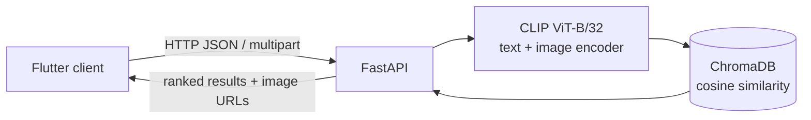

# Visual Search

Multimodal product search. Search a fashion catalog by text or by photo. CLIP embeddings, ChromaDB vector search, FastAPI backend, Flutter client.


## Features

- Text to image search ("red running shoes")
- Image to image search (upload a photo, get similar products)
- Color filter on top of semantic search
- Adaptive score threshold that drops low-confidence matches
- Request timeout (504), upload size limit (413), input validation (400)
- Flutter client with Provider state management, loading, empty and error states

## Architecture




Offline, `scripts/ingest.py` embeds catalog images with CLIP and stores them in ChromaDB. Online, the API embeds the query, runs nearest-neighbor search, filters by score, and returns JSON.

## Results

Measured on a MacBook (Apple Silicon, MPS) with 8,000 indexed products. 30 text queries after one warm-up request, single client, local network.

| Metric | Value |
|---|---|
| Median latency | 19 ms |
| p95 latency | 64 ms |
| Slowest request | about 1.1 s |

## Screenshots

| Text search | Photo search | Color filter |
|---|---|---|
|  |  |  |

## Tech stack

| Layer | Tools |
|---|---|
| Model | CLIP (`openai/clip-vit-base-patch32`) via Hugging Face Transformers, PyTorch |
| Vector DB | ChromaDB (persistent, cosine space) |
| Backend | FastAPI, Uvicorn |
| Client | Flutter, Provider, http, image_picker |
| Data | Fashion Product Images (Small), Kaggle |

## Project structure

```
visual-search/
├── app/main.py            # FastAPI service
├── scripts/ingest.py      # builds the ChromaDB index
├── scripts/benchmark.py   # latency measurement
├── flutter_app/           # Flutter client
├── docs/                  # screenshots, interactive diagram
└── requirements.txt
```

## Run locally

Requires Python 3.12 and Flutter.

```bash
conda create -n visual-search python=3.12
conda activate visual-search
pip install -r requirements.txt
```

Download the dataset from Kaggle ("Fashion Product Images (Small)") and unzip it so you have:

```
data/fashion/images/
data/fashion/styles.csv
```

Build the index, then start the API:

```bash
python scripts/ingest.py
uvicorn app.main:app --reload
```

Run the client in a second terminal:

```bash
cd flutter_app
flutter run -d chrome
```

API docs are at `http://127.0.0.1:8000/docs`. To reproduce the latency numbers, run `python scripts/benchmark.py` with the server up.

## API

| Endpoint | Method | Description |
|---|---|---|
| `/search/text` | POST | JSON `{"query": "...", "top_k": 10, "color": "Red"}` |
| `/search/image` | POST | multipart `file`, optional `top_k`, `color` |
| `/colors` | GET | Colors present in the index |
| `/health` | GET | Status and indexed item count |

Responses include `threshold_used`, `count`, and `results` (id, name, article, color, score, image_url).

## Design notes

- **Adaptive threshold.** The cut-off is `max(floor, best_score - margin)`, so results stay relevant whether the best match is strong or weak. Text and image queries use different floors, because CLIP text-to-image similarities are much lower than image-to-image ones.
- **Color.** CLIP weights object semantics more than color, so a red shirt photo can return black shirts. An optional metadata color filter handles that case.
- **Timeouts.** Inference runs in a thread pool under a 15 s limit and returns HTTP 504 when exceeded.

## Limitations and next steps

- English queries only. CLIP is trained on English text.
- The index holds a random 8,000-item sample of the catalog.
- No Docker image or hosted demo yet.
- Evaluation is manual. A labeled query set with precision@k would be the next step.

## Acknowledgments

Dataset: Fashion Product Images (Small) by Param Aggarwal on Kaggle. Model: OpenAI CLIP.